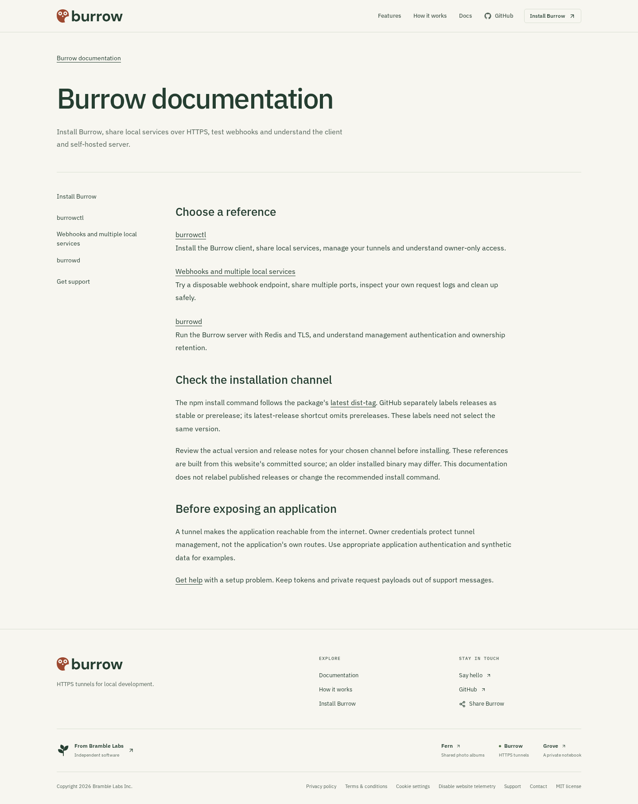
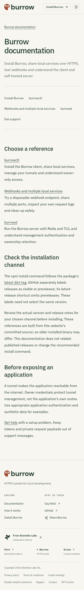
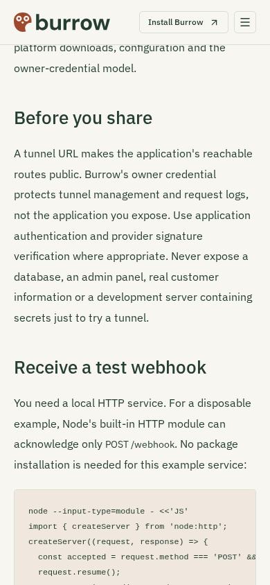

# Burrow reference and webhook guide

Actual local production build of this PR, Chromium, JavaScript disabled, reduced
motion and 1× scale. Existing light-theme Plex typography and site chrome retained.
The hub captures are full-page at 1440×1000 and 390×844; the worked-example image
is a mobile viewport scrolled to its webhook section. Synthetic instructions only.

| Hub, desktop                                  | Hub, mobile                                 | Webhook reference, mobile                      |
| --------------------------------------------- | ------------------------------------------- | ---------------------------------------------- |
|  |  |  |

Reviewed wrapping, readable code, safety boundaries and no page overflow. A separate
axe 4.14.0 operator audit passed WCAG A/AA on the hub and all three documents at
390px; keyboard-focusable code/table areas scroll independently. Regressions cover
320/390/768/1440px. The actual Node example returned 204 for the expected POST and
404 for GET/wrong path on a disposable loopback port.

No production tunnel, provider callback, real credential or customer traffic is
shown or qualified. Existing design-kit/font provenance is unchanged.
