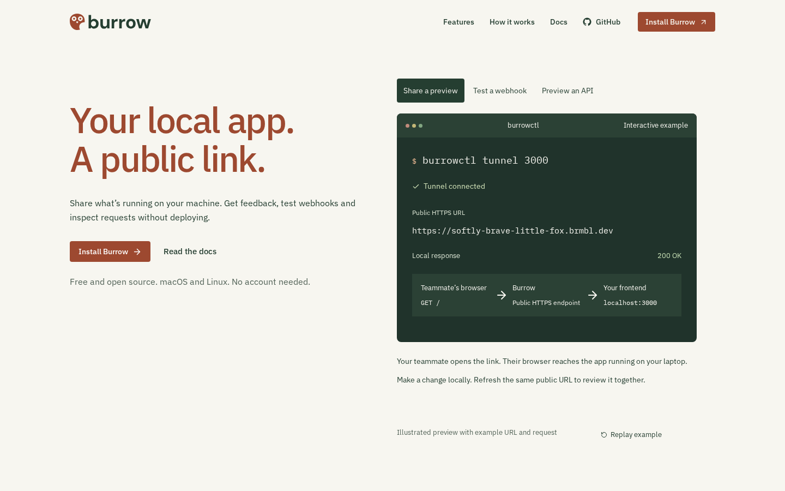
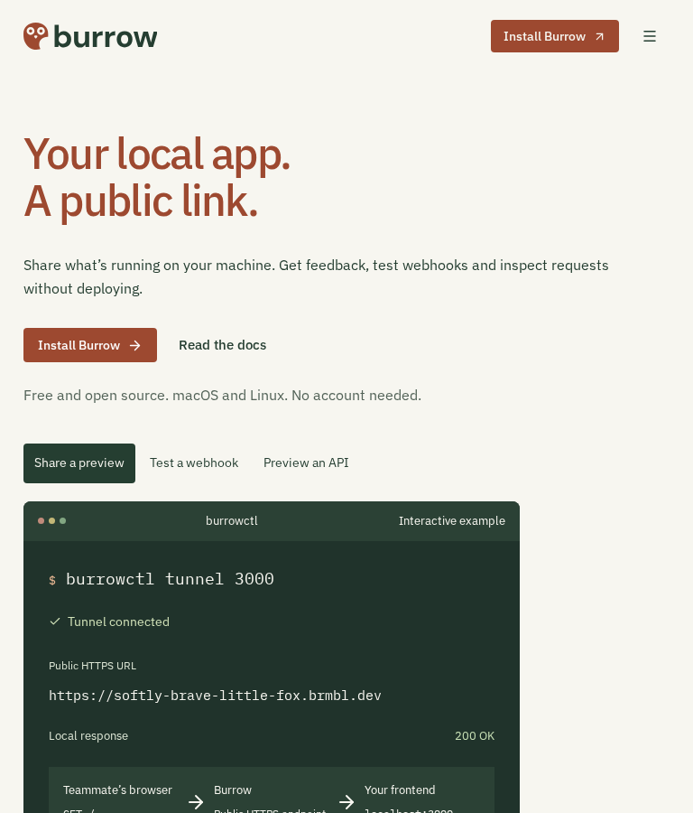
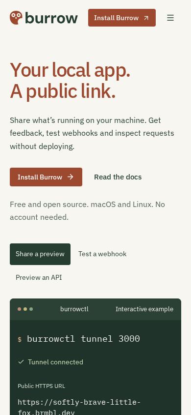
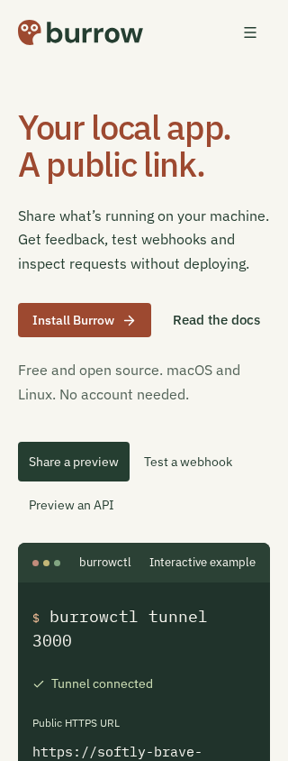
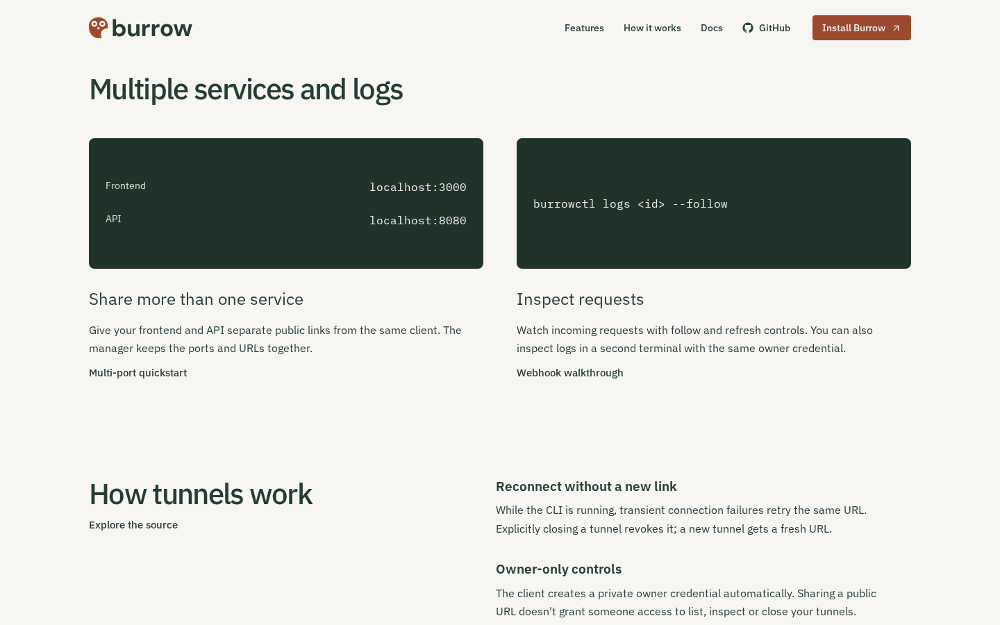
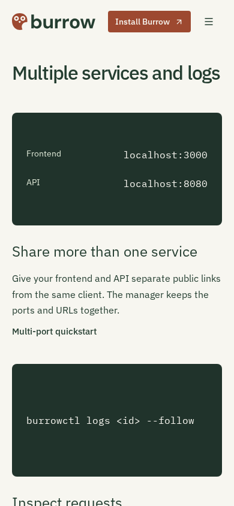

# Burrow website review

Local optimized Next.js build, Chromium on Linux, 6 November 2026. Viewports:
1440×900, 768×900, 390×844 and 320×844. Optional cookies were declined through
the existing UI. Terminal URLs, requests and ports are labelled examples; no
tunnel was opened. **No kit website artwork or new share composition is shipped.**

## Verification

Root/website lint, types/build, **42 browser cases**, all three Go modules' vet/tests,
64 CI/release contracts and workflow lint pass. Four-width homepage checks find
zero axe violations, positive overflow or heading collisions after notice
dismissal. Identity-only served hashes and the artwork exclusion pass. Light/dark
favicon media and SVG rendering at 16/32px pass; toolbar caching and other browser
engines are not certified. These checks do not prove live-tunnel deployment.

Raw taste findings include `few-pictures`, notice overlap and hidden closed
consent controls. Explicit reviewed exceptions: `few-pictures,covered-text,reduced-hidden`.
The owner excludes kit website art; adding stock or redundant panels to meet the
four-picture floor would weaken the terminal-led page. An independent four-width
heading probe passes after ordinary dismissal. Existing brand-paper, consent
outline and no-footage warnings remain, with consent tests unchanged.

## Final critique — round 2

Seen in one second: a local app becoming a public link.
Idea: the command and request path become the page's practical demonstration.
Live thing: change preview/webhook/API scenarios and inspect manager requests.
Layout words: hero=terminal / setup=commands / workflow=service pair / manager=working example / close=privacy and questions.
Scores: design 6.5 · usability 8.5 · creativity 7 · content 9 → **7.4/10**.
Caps applied: fewer than four pictures; below the skill's 7.5 target, not rounded up.
Remaining tradeoffs:

1. `home-phone.png`: full request-route states take space; preserve their stable reserve.
2. `detail-desktop.png`: port and log panels are deliberately quiet examples, not invented live status.
3. `home-tablet.png`: the manager remains dense; retain the actual terminal character instead of decorative artwork.

| Desktop                      | Tablet                     | Phone                    |
| ---------------------------- | -------------------------- | ------------------------ |
|  |  |  |

| Small phone                    | Service detail                  | Phone detail                        |
| ------------------------------ | ------------------------------- | ----------------------------------- |
|  |  |  |
