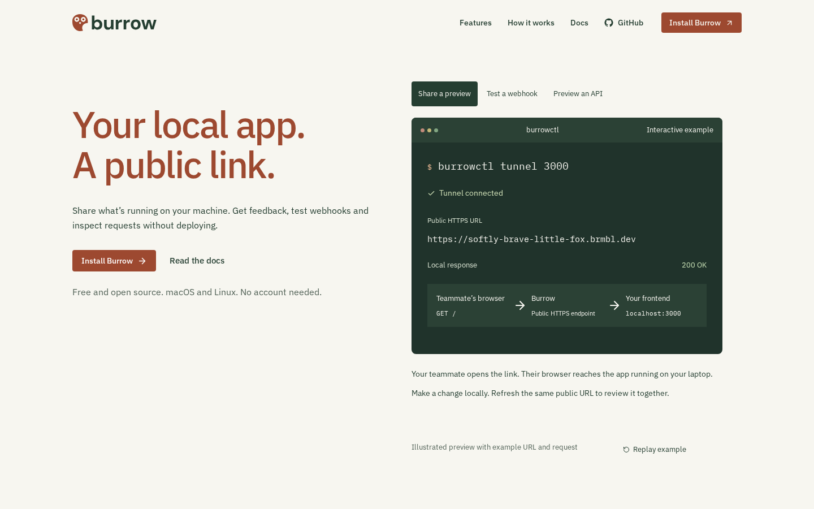
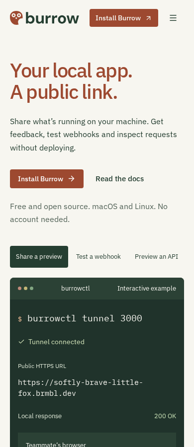
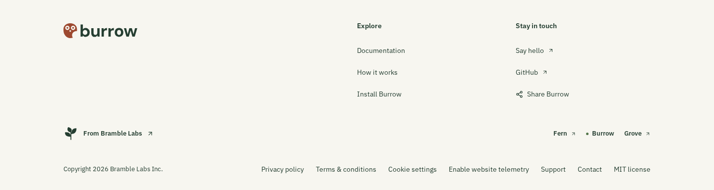
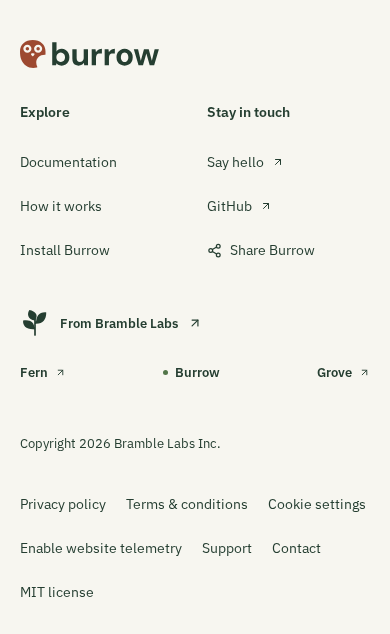

# Burrow terminal-led landing page

Reviewed local optimized-build captures of the live-layout-led polish pass.
[Capture provenance](capture.json) records the source fingerprint, build ID,
browser, viewports and synthetic-data boundary.

Captured from the local optimized Next.js build of `feature/website-product-refresh`.
Rust actions, IBM Plex type and working dark terminal examples distinguish the tool.
Installation instructions stay on paper with a matching readable foreground; manager
tabs are readable outside the terminal in their selected and unselected states.

| Desktop — 1440 × 900                  | Phone — 390 × 900                  |
| ------------------------------------- | ---------------------------------- |
|  |  |

[Tablet, 768 × 900](home-768.png) · [Small phone, 320 × 900](home-320.png) · [Full desktop page](home-page-1440.png) ·
[Full phone page](home-page-390.png)

| Compact footer — desktop                                           | Compact footer — phone                            |
| ------------------------------------------------------------------ | ------------------------------------------------- |
|  |  |

The 4 November kit guidelines govern Plex Sans hero/section headings, Plex Mono
commands and the approved Arc signature in the compact footer. There is no
separate giant-name row; footer controls retain a minimum 44px target.

[Installation, desktop](walkthrough-1440.png) · [Phone](walkthrough-390.png) ·
[Selected webhook, desktop](webhook-1440.png) · [Phone](webhook-390.png) ·
[Tablet page](home-page-768.png) · [Small-phone page](home-page-320.png) ·
[Keyboard focus](home-focus-1440.png) · [200% CSS zoom reflow](home-zoom-200.png).
The zoom capture checks CSS reflow, not native browser zoom or physical-device accessibility.

Commands use the implemented CLI. The terminal and manager contain synthetic URLs,
ports and requests, never a live tunnel or customer traffic. The page distinguishes
public app access from owner-only management, and states platform and telemetry limits.
The code photograph is a local derivative of a retained marketing-kit master;
its source, licence and hashes are in the
[asset manifest](../../../../packages/website/public/images/kit/manifest.json).
[Client setup and troubleshooting](docs-client-page-390.png) use the maintained guide.

Optional cookies were declined through the real notice before capture. Consent,
clipboard failure and keyboard interactions are independently covered by browser
tests. These captures are local source evidence, not a deployment or live tunnel test.
