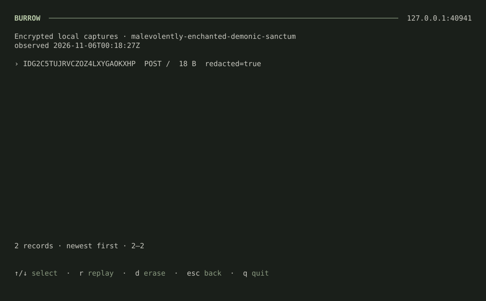
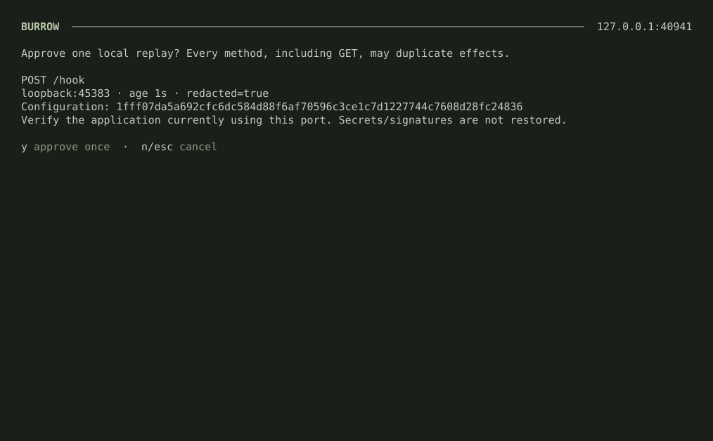
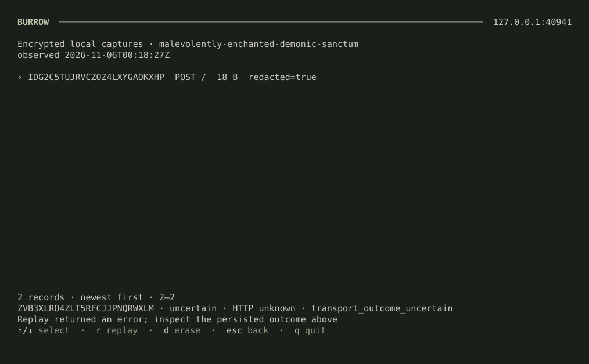

# Tunnel workflow implementation

This records the merged development implementation of the
[workflow development plan](tunnel-workflows-plan.md), not a release announcement.
The owner merged #84, #88 and #90 in order. The implementation was delivered as
PR #90 stacked on #88, with an explicit split of
macOS secure capture into [draft follow-up #91](https://github.com/miniaxolotl/burrow/pull/91)
because native macOS hardware is currently unavailable. #88 preserves the initial
headless checkpoint; #90 delivers the remaining workflows with **Linux-only capture
and replay**. Ordinary macOS tunneling, aliases, routing and headless mode remain
available; they do not enable capture. #91 remains a draft targeting development.
The [operations implementation](tunnel-operations-implementation.md), stacked on
the separate [operations plan](tunnel-operations-plan.md), extends this baseline;
it is not part of the historical workflow acceptance recorded below.

## Checkpoints

| Checkpoint                                     | Status                                                                                                                                                                                           |
| ---------------------------------------------- | ------------------------------------------------------------------------------------------------------------------------------------------------------------------------------------------------ |
| Isolated CLI subprocess fixtures               | Implemented: temporary HOME, no inherited owner/server configuration, private-owner and help/validation baselines.                                                                               |
| Headless lifecycle and structured output       | Implemented: headless/TTY detection, JSON/JSONL, numeric units, truthful transport events, signals/cancellation and bounded output/drain; exercised in the Linux combined scenario.              |
| Registration acknowledgement and saved aliases | Implemented: negotiated acknowledgement, aggregate readiness, durable attachment CAS/nonce reconciliation, private locked aliases and close/replacement state; restart and partition tests pass. |
| One-hostname local routing                     | Implemented: strict config, bounded private HTTP adapter, loopback routing, upgrade/SSE/trailer compatibility and scrollable TUI route table; exercised in the combined scenario.                |
| Encrypted capture and durable local replay     | Linux CLI, native TUI, real-service combination and storage/crash tests pass. macOS adapter and native acceptance are separately deferred in #91, not a #90 blocker.                             |
| Combined acceptance and full exact-head gates  | Linux combined acceptance passed; native PR CI passed all nine jobs at #88 head a1fc16b and #90 head 94c50df before merge.                                                                       |

Each checkpoint uses focused passing commits with matching tests and documentation.
The merged #90 uses the Linux capture scope above; #91 stays draft until its
macOS implementation and native acceptance pass. No production
deployment or public tunnel is part of these tests. Capture fixtures use only
synthetic application content and isolated credential facilities.

Final native PR evidence: [#88 CI](https://github.com/miniaxolotl/burrow/actions/runs/42150609083)
and [#90 CI](https://github.com/miniaxolotl/burrow/actions/runs/42150627605). Their
heads include the native-stack admission repair; earlier independent green
source dispatches alone did not establish merge readiness. The merged development
tree at `4f5340b` exactly matched tested #90 head `94c50df`. Historical checkpoint
details below retain the original verification/toolchain context.

## Implemented checkpoint evidence

- Subprocess fixtures use temporary HOME, private generated owners, synthetic
  loopback HTTP/WebSocket/yamux peers and disabled telemetry. They do not load the
  operator's credentials or connect to the hosted Burrow service.
- Red/green regressions cover structured results/errors, argument exit codes,
  real local forwarding, SIGTERM, partial startup rollback, repeated log snapshots,
  terminal reconnect failure, numeric units/unknown HTTP status, broken stdout and
  stalled writes. A stalled WebSocket upgrade is cancelled by closing only the
  handshake socket, without closing an accepted session on internal dial cleanup.
- Full normal Go tests and vet pass locally. The full race suite also passed in
  the existing Go 1.26.10 container with network disabled and read-only source/cache;
  rerun it on each published checkpoint. The host itself has no C compiler.
- #88 has no registration acknowledgement. The child adds negotiated registration
  and aggregate `ready` / `not_ready`; stable aliases, routing and capture/replay
  are not implied by that barrier. The Linux combined scenario below separately
  verifies the implemented feature combination.

### Registration protocol

Clients offer `X-Burrow-Registration: 1`; servers echo it only when supported.
Other requested versions are rejected before ownership reservation. Without the
echo, new clients retain transport-only legacy behavior and never emit `ready`.
No application probe is sent.

The first server-opened yamux stream is reserved for a single JSON registration
object followed by EOF, capped at 2048 bytes: version 1, tunnel ID and generation.
The server opens this stream before exposing the session, then writes only after
Redis registration and active-session installation. HTTP uses separate streams.
The server write deadline is five seconds; client acceptance/read is within the
30-second connection/startup deadline and cancelled with the command. Invalid,
oversized or mismatched acknowledgements fail startup. No control data is sent
to legacy clients.

`connected` reports transport establishment; `registered` includes the matching
generation and `registration_confirmed: true`. Aggregate `ready` contains all
acknowledged IDs/generations/URLs. Loss emits `not_ready` before reconnect details;
recovery needs fresh acknowledgements for every tunnel. Neither registration nor
a response status proves application processing succeeded.

### Persistent attachment evidence

Server unit tests cover conditional/idempotent commit, metadata expiry, stale
refresh/cleanup, revocation and legacy bypass; live loopback tests reject busy
sessions. Private-registry tests cover restart/uncertain attempt reuse, scope,
locking, corrupt/newer schemas, symlinks/permissions and close/replacement races.
An actual CLI subprocess reuses its URL after metadata removal and server restart
with retained Redis. This passed against both miniredis and a disposable Redis
7.4 container. The focused restart fixture shortens disconnect grace; the combined
fixture below also verifies the real default grace. A real half-open transport
fixture below verifies the default liveness bound too. No hosted service
or public tunnel is involved.

The rollout path now enforces the attachment-state image compatibility floor
documented in [deployment guidance](deploy.md). Release-policy tests include the
new guard without weakening current-ref or single-instance checks.

### Capture/replay storage decision and evidence

The optional store uses `modernc.org/sqlite v1.61.1` (pure Go, pinned) and an
AES-GCM scope key in the OS credential facility. Review rejected `go-keyring`'s
automatic unlock/prompt behavior. The Linux adapter instead uses maintained
`godbus/dbus` with bounded calls and never calls Unlock/Prompt. Linux tests cover
a real isolated unlocked Secret Service, a locked collection (existing/new key),
and an absent backend. A real CLI capture → restart → list → local replay → delete
passed with that disposable backend. macOS deliberately fails capture closed;
the no-prompt Keychain adapter and native acceptance belong to #91, not #90.
Cross-compilation is not evidence of secure-backend support.

SQLite receives ciphertext only, including sensitive request metadata. Each
ciphertext authenticates schema, scope and record ID. Tests inspect files for
synthetic plaintext, reject ciphertext swaps, fence clear/delete/expiry races,
and verify nonblocking bounded capture under a stopped writer. The reviewed
20 MiB payload budget reserves room for a bounded database and rollback journal
under the proposal's 50 MiB physical envelope.

Replay work and leases live in the same transactional store. Tests cover durable
intent, linked approval, no automatic resends after disconnect, explicit erasure
during dispatch, distinct HTTP 500/completed outcome and actual test-worker crashes
after claim, after intent, after upstream receipt and after result commit. Recovery
uses that durable evidence and never redispatches the old job. The real-service
Linux combination is verified separately below; neither set proves macOS support
or every possible filesystem outage.

### Real-service and native terminal acceptance

`scripts/test/secure-backend.py` creates its own temporary HOME and session bus,
unlocks a disposable GNOME keyring with a synthetic fixture password and cleans
up its own service. It never uses an operator's credential session. With
`BURROW_TEST_REDIS` pointed at a disposable Redis, it also runs the combined test:

```sh
BURROW_TEST_REDIS=redis://127.0.0.1:PORT python3 scripts/test/secure-backend.py
```

The combined real-Redis/real-credential-backend test passed: named routed capture,
original request forwarding, actual default 20-second disconnect grace, metadata
removal, restart without capture opt-in, server restart with retained Redis, and
approved direct local replay while the Burrow server is offline. The URL stays
the same and local application call counts show exactly one approved resend.

The native TUI test runs the actual CLI in an isolated tmux terminal (110×32), not
a rendered mock. It verifies capture selection/visible-row stability when new
records arrive, cancellation/back from confirmation, approved replay, completed
HTTP 200/500, uncertain disconnect without automatic resend and confirmed erasure.
The test caught an ANSI-length truncation bug in the footer; it was fixed using
ANSI-aware upstream layout, without relaxing the check.

Rendered captures of that terminal, synthetic data only:

| Captures                                                      | Approval                                                               | Uncertain outcome                                                           |
| ------------------------------------------------------------- | ---------------------------------------------------------------------- | --------------------------------------------------------------------------- |
|  |  |  |

Other captures: [completed HTTP 200](previews/tunnel-workflows/capture-replay-completed.svg),
[completed HTTP 500](previews/tunnel-workflows/capture-replay-http-failure.svg).
To regenerate the SVGs, set `BURROW_TEST_TUI_CAPTURE_DIR` to a temporary directory
when running the fixture, then use `scripts/test/render-terminal-captures.py`.

The partition fixture pauses both directions without closing TCP or responding to
yamux pings. Busy admission remains rejected while it is live; the server expires
it in 30.03 seconds (10-second heartbeat plus 20-second timeout, with test scheduling
tolerance) and admits a conditional new generation, without waiting for metadata
expiry. Enable this real-time gate with `BURROW_TEST_LIVENESS=1`.

Storage fault tests force SQLite full and read-only writes: failed publication is
not replayable, failed job commits leave no accepted work, competing workers cannot
claim the same scope and stale workers cannot overwrite uncertain outcomes. These
controlled SQLite failures are not proof of every OS/filesystem outage mode.

The owner moved macOS capture implementation/native acceptance to #91; it no
longer blocks #90. The non-Linux rejection guard stays in place, and no native
macOS capture test is claimed. Final exact-head native CI is linked above.

The final uncached parallel pass found a test-only fixed-sleep assumption after
CLI exit. The server may observe that disconnect later under load. Restart
fixtures now wait on actual registry metadata removal within bounded deadlines;
the grace values are unchanged. The focused restart regression passed 30 repeated
runs on Go 1.26.2 after this change.

### Standalone image-build regression

Source CI found that workspace dependency synchronization had updated module
requirements without retaining every standalone `go.mod` checksum in the server
and protocol `go.sum` files. Workspace builds passed, but the server-only Docker
context failed on `golang.org/x/sys v0.49.0`. The same Docker failure reproduced
locally. Regenerating each affected module's download checksums with `GOWORK=off`
fixed the image build without changing dependency versions or Docker behavior.
A policy regression now checks declared external requirement checksums in all
three modules. The full Docker image and standalone readonly client/protocol
builds passed after the repair; source CI remains a separate exact-head gate.

### Signal-cause compatibility regression

The first full source CI run caught a Go 1.26.2-specific cancellation case: an
interrupted HTTP request can wrap the signal context's cause (`terminated signal
received`) rather than `context.Canceled`. The CLI now recognizes either the
cancelled command context's error or its cause, without treating unrelated errors
as clean shutdown. Text and JSON subprocess regressions cover it; both passed
500 repetitions each on CI's exact Go 1.26.2 toolchain after the fix. Do not infer
CI success from a newer local toolchain's passing result alone.
